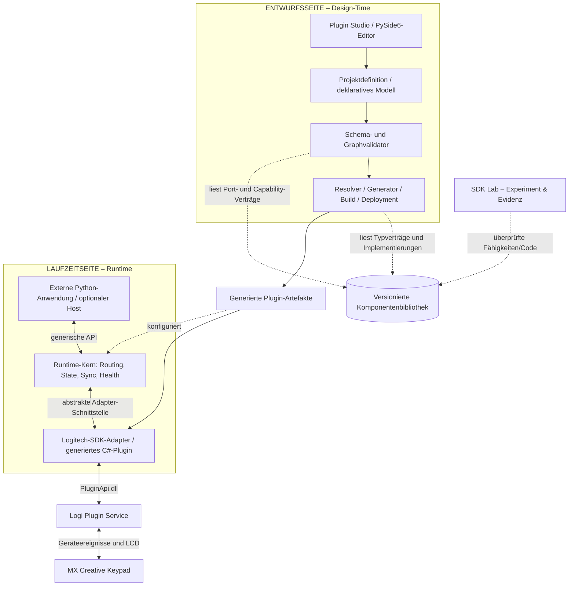
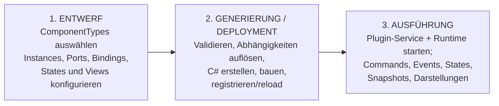

# 02 – Ebenenmodell und klare Verantwortlichkeiten

> **SDK-native Fortschreibung 03.11.2026:** [ARCH-ADR-001](decisions/ARCH-ADR-001.md) ist für **neue** Modellierungsarbeiten vorrangig. Das Diagramm und die Matrix unten beschreiben überwiegend die **bestehenden Komponenten des alten fachneutralen Pfads**, nicht ein verpflichtendes zukünftiges SDK-unabhängiges Kernmodell. Native Fachsemantik verbleibt beim SDK; die Bridge trägt nur sprach-/prozessbedingte Integration, Komfort liegt darüber.

**Status:** Schichtentrennung als vereinbarte Baseline; konkrete Klassen und Prozesse sind Entwurfsentscheidungen.  
**Zentraler Hinweis:** Wir unterscheiden **Verantwortungsbereiche** (wer macht was?) und **Lebenszyklusphasen** (wann passiert was?). Die beiden dürfen nicht zu einer einzigen Hierarchie vermischt werden.

## A. Systemlandkarte: Wer gehört wozu?

**Leseregel:** Die durchgezogenen Pfeile zeigen Abhängigkeiten bzw. Kommunikation; die gestrichelten Pfeile zeigen, wie Verträge und überprüfter Code genutzt werden. Das Diagramm behauptet keine bereits implementierte generische Runtime.

## B. Verantwortungsmatrix

| Verantwortungsbereich | Enthält | Verantwortlich für | Ausdrücklich **nicht** verantwortlich für |
|---|---|---|---|
| **SDK Lab** | Demonstrationen, Hardwaretests, Diagnoselog | SDK-Verhalten erproben und Evidenz sammeln | Produktkonfiguration eines Benutzerplugins |
| **Studio (Editor)** | Projektseiten, Objekteditoren, Preview | Modell bearbeiten, Benutzer führen, validierbare Daten erzeugen | Live-Ausführung einer Benutzeranwendung |
| **Projektdefinition** | IDs, Typinstanzen, Bindings, States, Views, Assets | *Was* ein konkretes Plugin sein soll | Hardware ansprechen oder Prozesse ausführen |
| **Komponentenbibliothek** | Manifeste, generische Implementierungen, Testnachweise | *Wie* ein Bausteintyp technisch umgesetzt wird | Feste projektspezifische Aktionsnamen vorgeben |
| **Resolver/Validator** | Typauflösung, Referenzen, Capabilities | Modellkonsistenz und Realisierbarkeit prüfen | Automatisch Fehler „erraten“ und stillschweigend korrigieren |
| **Generator/Builder** | Vorlagen, Compiler-Aufruf, Paketmetadaten | Modell + Bibliothek in installierbare Artefakte überführen | Aktuelle fachliche Zustände erfinden |
| **Deployment** | Plugin-Registrierung, gezielter Reload, Log | Installieren und aktualisieren | Ungefragt andere Plugins global neustarten |
| **Runtime-Kern** | Message-Router, State-Replikate, Snapshot, Reconnect, Health | Laufenden Datenfluss und technische Konsistenz garantieren | Fachlichen Sinn eines State-Werts kennen |
| **Host-Adapter** | Python-Bindings, Qt-Signalbrücke, optional andere Hosts | Externe Anwendung an generische Verträge anschließen | Hardware-API duplizieren |
| **Geräteadapter** | Logitech-C#-SDK-Aufrufe, Bilder, Ordner-Notifications | Abstraktes Modell auf tatsächliches SDK abbilden | Benutzerlogik im Editor oder Projekt verankern |
| **Logi Plugin Service** | Logitech-Laufzeitumgebung | Plugin hosten und Hardware bedienen | Studio-Projektdatei interpretieren müssen |
| **MX Creative Keypad** | Tasten/LCD | Eingabe und Darstellung | Zustandsautorität der Anwendung sein |

## C. Drei Lebenszyklusphasen – und was dort existiert

| Artefakt/Objekt | Entwurf | Build/Deployment | Laufzeit |
|---|---|---|---|
| `ComponentType`-Manifest | wird gelesen | zur Umsetzung aufgelöst | nicht zwingend als Manifest benötigt |
| `ComponentInstance`-Definition | wird gespeichert | wird in Artefakte überführt | konkrete Ausführung erhält eine Runtime-Instanz |
| `Binding`-Definition | wird editiert | syntaktisch und semantisch geprüft | wird als Routingregeln angewandt |
| `StateDefinition` | Wertvertrag/Autorität | validiert und bereitgestellt | aktueller Wert, Revision, Qualität werden verwaltet |
| `View` / `Placement` | gewünschte Positionen | Gerätefähigkeiten geprüft | tatsächlich sichtbare Belegung; ggf. Override |
| `Presentation` | Varianten/Assets | Ressourcen verarbeitet | gewählte Variante wird gerendert |
| `Studio` | ist geöffnet | startet Aufgaben | **nicht erforderlich** |
| Externe Python-App | muss nicht laufen | kann integriert/konfiguriert werden | verarbeitet Commands; setzt autoritative Werte |

## D. Wichtigste Grenzen anhand von Beispielen

### 1. Neue Aktion hinzufügen

- **Editor:** legt `action.secondary` als neue `ComponentInstance` an.
- **Projektdefinition:** enthält ID, ComponentType, Konfiguration, Bindings und Placements.
- **Generator:** erzeugt/re-konfiguriert notwendige SDK-Actions; für neue Host-Registrierungen kann ein Reload nötig sein.
- **Runtime:** reagiert danach auf deren Aktivierung.
- **Gerät:** zeigt die Aktion erst, wenn sie im tatsächlich verfügbaren Layout/Profil platziert ist.

### 2. Aktuelle Beschriftung ändern

- **Python-Anwendung:** ändert einen autoritativen State oder einen erlaubten Anzeige-Override.
- **Runtime:** verarbeitet die Änderung mit Revision; informiert abhängige Presentations.
- **Adapter:** löst SDK-Bild-/Textaktualisierung aus.
- **Hardware:** erhält neue LCD-Daten, soweit unterstützt.
- **Studio-Projekt:** **bleibt unverändert**, außer der Benutzer speichert explizit eine neue Designkonfiguration.

### 3. Dynamic Folder von N auf M Mitglieder ändern

- Die **View** ist eine logische Collection von Placements; die **Runtime** erhält eine neue Version der Collection.
- Der **Geräteadapter** übersetzt die Änderung in unterstützte SDK-Notifications (`ButtonActionNamesChanged` etc.).
- Die physische Gerätefläche hat konkrete Kapazitätsgrenzen; logische Views dürfen umfangreicher sein, müssen dann nach einer expliziten Adapter-/Navigationsregel abgebildet werden.
- Eine im Lab getestete 4↔8-Änderung beweist den Mechanismus, **nicht** eine unbegrenzte Zahl gleichzeitig sichtbarer Hardware-Tasten.

### 4. Plugin Service neu starten

- Der C#-Adapter wird ggf. neu geladen und verliert flüchtige lokale Daten.
- Die externe Python-Anwendung kann unabhängig weiterlaufen.
- Die Runtime verbindet sich neu und synchronisiert per Snapshot.
- **Erhalt über Logitech-Service-Neustart ≠ Persistenz über Python-Neustart.**

## E. Zwei Achsen, die man niemals vermengen sollte

1. **Logische Modell-Ebene:** Project → ComponentInstance → Port/Binding/State/View. Das ist die Struktur der *Beschreibung*.
2. **Technische Laufzeit-Ebene:** Python-App ↔ Runtime ↔ C#-Adapter ↔ Plugin Service ↔ Hardware. Das ist die Struktur der *Ausführung*.

Eine `ComponentInstance` ist keine zwingend eigenständige Python-Klasse oder ein eigener OS-Prozess. Ein `Binding` ist ein fachneutraler Graphknoten/-rand, **kein** Netzwerkport. Ein `State` ist ein Vertrag mit einem aktuellen Wert, **kein** fest verdrahtetes LCD-Feld.

**Weiter:** [Metamodell](03_Metamodell.md), [Entstehung](05_Vom_Projekt_zum_Plugin.md), [Glossar](04_Begriffslexikon.md).

## F. Neues Vorrangprinzip für Schichten

Die fachliche Richtung ist nun **SDK → schmale Python/C#-Bridge → optionale Studio-Komfortschicht**. Die bisherige Entwurfs-/Runtime-Trennung bleibt als technische Sicherheits- und Lebenszyklusgrenze erhalten, ist aber **keine Rechtfertigung für ein eigenes Pflicht-Metamodell**. Die Widget- und Generator-Schichten dürfen keine SDK-Fähigkeit stillschweigend reduzieren. [ADR](decisions/ARCH-ADR-001.md).
