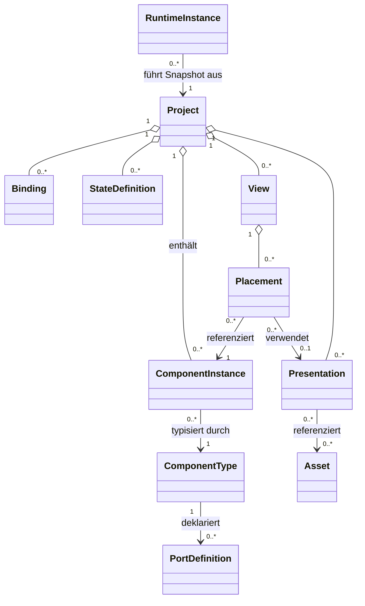
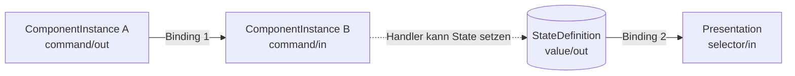

# 03 – Metamodell: Entitäten, Beziehungen und Regeln

> **Neue Zielrichtung 03.11.2026:** [ARCH-ADR-001](decisions/ARCH-ADR-001.md) überholt das SDK-agnostische Metamodell als *fachlich führende* Zukunftsarchitektur. Die folgenden Entitäten und Tabellen sind **bestehender Entwurfs-/Codebestand `0.1-draft`** und müssen erst gegen native Actions, `actionParameter`, Multistate, Adjustments, Folders und ICT gemappt werden. [Abgleich](specifications/sdk-native-modellabgleich-v01.md). Keine automatische Migration.

**Status:** erläutertes **v0.2-Gesamtmodell weiterhin Entwurf**; P0-ADR-001..007 sind seit dem 30.10.2026 mit Ausnahmegrenze zu ADR-005 freigegeben. **Kein finales Projekt-JSON-Schema.**  
**Basis:** `../references/architecture-history/ARCHITEKTURMODELL_v0.1.md` (Baseline), `../references/architecture-history/METAMODELL_ENTWURF_v0.2.md` (Diskussionsentwurf).

## 1. Metamodell versus Projektmodell

Ein **Metamodell** definiert, welche Arten von Elementen ein Studio-Projekt enthalten darf, welche Eigenschaften und Beziehungen diese besitzen und wie deren Gültigkeit geprüft wird.

Ein **Projektmodell** ist eine konkrete Anwendung dieser Sprache, etwa ein Plugin mit drei individuellen Aktionen, zwei Ordnern und fünf Zuständen. Eine daraus erzeugte SDK-DLL ist **nicht** das Projektmodell, sondern ein abgeleitetes Ausführungsartefakt.

```text
METAMODELL: "Ein Project enthält ComponentInstances, States, Bindings, Views ..."
       │ beschreibt erlaubte Formen
       ▼
PROJEKTMODELL: "Projekt X enthält ComponentInstance A, State S, Binding B ..."
       │ wird validiert und übersetzt
       ▼
ARTEFAKT: C#-Plugin + Konfiguration + optionale Host-Runtime
       │ wird vom Logitech Plugin Service geladen
       ▼
LAUFZEIT: aktuelle Instanzen, Werte, Sessions, Platzierungen
```

## 2. Entitäten und ihre Eigentümer

| Entität | Was ist das? | Ort bzw. Owner | Wesentliche Felder (Entwurf) |
|---|---|---|---|
| `Project` | Wurzel der Modellierung | Projektdatei | `schema_version`, `id`, `metadata`, `dependencies` |
| `ComponentType` | versionierter Bauplan eines Bausteins | Bibliothek | `type_id`, `version`, `config_schema`, `ports`, `capabilities` |
| `PortDefinition` | deklarierter Anschluss des Typs | Typmanifest | `id`, `direction`, `kind`, `payload_schema` |
| `ComponentInstance` | konkrete Konfiguration eines Typs | Projekt | `id`, `type`, `config` |
| `Endpoint` | referenzierter Anschluss an einer Instanz/einem anderen Element | aus Modell abgeleitet | `owner_ref`, `port_id` |
| `StateDefinition` | Schema und Regeln eines aktuellen Werts | Projekt | `id`, `value_schema`, `authority`, `scope`, `persistence` |
| `Binding` | Verbindung zweier kompatibler Endpoints | Projekt | `id`, `source`, `target`, `kind`, `mapping?`, `condition?` |
| `View` | logischer darstellbarer Container | Projekt | `id`, `type`, `layout`, `placements` |
| `Placement` | referenzierte Verwendung an bestimmter Stelle | Projekt, Bestandteil einer View | `id`, `component_ref`, `presentation_ref`, `position` |
| `Presentation` | Darstellung und Varianten | Projekt | `id`, `variants`, `selector`, `assets` |
| `Asset` | Medienressource mit Metadaten | Projektressourcen | `id`, `path`, `media_type`, `sha256?` |
| `Capability` | prüfbare Fähigkeit oder Limit | Bibliothek/Geräteadapter | `id`, Version, Parameter / Grenzen |
| `RuntimeInstance` | aktive Ausführung, nicht im Projekt gespeicherter Ist-Zustand | Runtime | `runtime_instance_id`, `session_id`, aktuelle Values, Status |

Die Liste als **Gesamtmenge** bleibt ein Vorschlag. **Verbindlich nach ADR-002** ist die Trennung von Typmanifesten, persistierten Projektentitäten und Runtime-Objekten. Nicht jede konzeptionelle Entität muss als eigener persistierter JSON-Block existieren; `Endpoint` wird aus qualifizierten Referenzen abgeleitet.

## 3. Relationen / Kardinalitäten



**Interpretation:** Eine ComponentInstance kann in beliebig vielen Placements benutzt werden. Das Erzeugen einer zweiten Platzierung dupliziert weder die Aktion noch automatisch ihren Zustand. `RuntimeInstance` ist das Laufzeitkonzept; es wird nicht in derselben statischen `components[]`-Liste persistiert.

## 4. Typ, Instanz, Placement – ein minimales Beispiel

- Bibliothek definiert `core.command_action@1.0` mit Port `activated`.
- Projekt definiert `component:action.primary` dieses Typs.
- View `view.main` enthält `placement.left`, das auf `action.primary` zeigt.
- View `view.more` enthält `placement.right`, das **ebenfalls** auf `action.primary` zeigt.
- Zwei Plätze können denselben **logischen Command** auslösen; nur ihre `Presentation` kann unterschiedlich sein.

Der Anzeigename ist eine Eigenschaft, keine Identität. Ein Umbenennen darf nicht alle Bindings unbrauchbar machen. Ob ein Gerät zwei Placements gleichzeitig auf zwei Hardware-Views anbieten kann, ist eine **Adapter-Capability**, nicht Teil der allgemeinen Komponentenlogik.

## 5. Ports und Endpoints

Ein Port gehört als **Definition** zu einem ComponentType. Erst die ComponentInstance macht daraus einen **adressierbaren Endpoint**. Der Port ist kein TCP/HTTP-Port.

| Eigenschaft | Beschreibung |
|---|---|
| `direction` | `in` oder `out` |
| `kind` | `command`, `event` oder `state` |
| `payload_schema` | erwartete Struktur und Werte (JSON-Schema-kompatibel) |
| `result_schema` | optional für Command-Result, **nicht** Ersatz für eine StateDefinition |
| `capabilities` | optionale Bedingungen, ob der Port auf Adapter X verwendbar ist |

Konzeptionelle Notation: `component:action.primary/activated`; `component:handler.primary/invoke`; `state:state.primary/value`; `presentation:visual.primary/selector`. **Die kanonische Speicherform ist durch P0-ADR-001 beschlossen:** qualifiziertes JSON-Objekt `{ "owner_kind": "component|state|presentation", "owner_id": "...", "port": "..." }`. Die obige Stringnotation ist nur für Menschen; verbleibende Editor-Rename-Abläufe sind noch zu spezifizieren.

### Drei Signalkategorien, keine implizite Konversion

- `command`: adressierte Ausführungsabsicht, die fehlschlagen kann.
- `event`: Information über ein stattgefundenes Vorkommnis.
- `state`: aktuellen Wert mit Revision und Aktualitätsqualität lesen/beobachten.

Direkte Verbindungen zwischen ungleichen Kategorien sind ungültig, solange kein expliziter Transformations-/Handlerbaustein vermittelt.

## 6. Bindings als typisierter Graph



**Validierung, die der Core-Model-Validator leisten soll:**

1. Jede Quelle und jedes Ziel existiert; IDs sind im vereinbarten Scope eindeutig.
2. Quelle hat Ausgangsrichtung; Ziel hat Eingangsrichtung.
3. Signalart und Nutzdatenschema passen zusammen oder eine **explizite** geprüfte Transformation existiert.
4. Referenzierter ComponentType ist in kompatibler Version vorhanden.
5. Benötigte Gerätefähigkeiten sind vorhanden; sonst wird ein Fehler bzw. expliziter eingeschränkter Modus gemeldet.
6. Keine unkontrollierten kombinatorischen Zyklen.
7. Zustands-Schreibautorität wird nicht nur in JSON behauptet, sondern in der Runtime durchgesetzt.

**Noch offen:** genaue Konflikt-/Fehlerpolitik mehrerer Bindings auf dasselbe Ziel; Ausdrucksgrammatik; Reihenfolge deterministischer Abarbeitung.

## 7. States und die Zeitdimension

Ein `StateDefinition` beschreibt **einen Typ samt Regelwerk**, kein ausschließlich aktuelles Wörterbuchfeld.

```text
Definition (Design-Time)       →  "state.primary: enum[variant_0, variant_1]"
Autoritativer Runtime-Wert     →  "variant_1", revision=19
Replizierter Wert im Adapter   →  "variant_1", revision=19, quality=fresh
Bei Verbindungsverlust        →  "variant_1", revision=19, quality=stale
```

- `authority`: eindeutige Instanz/Rolle, die Werte schreiben darf.
- `scope`: im bestehenden `0.1-draft` sind `project`, `component`, `placement`, `session` historische Schema-Kandidaten. **RT-ADR-002** hat für die V1-Runtime inzwischen `runtime`, `component`, `placement` beschlossen; `project` im Draft bedeutet runtimeweit, `session` ist kein regulärer fachlicher V1-Scope. Das ist **nicht** automatisch ein nativer Logitech-Multistate-Index.
- `lifetime`: wann wird ein Wert neu initialisiert/ungültig.
- `persistence`: Speicherpolitik (`none`, `runtime_local`, `external` als **Kandidaten**).
- `fallback`: Anzeige-/Initialwert, **kein Beweis eines realen Ist-Zustands**.
- `quality`: `unknown`, `fresh`, `stale` als vorgeschlagener Basissatz.

**Durch P0-ADR-005 verbindlich:** Ein konkreter State-Scope hat genau einen maßgeblichen Writer; wie solche Scopes und Writer bei mehreren Runtime-Instanzen aufgelöst werden, ist **nicht entschieden**. **Autorität ≠ Speicherort.** Ein State kann in Python autoritativ und im C#-Plugin repliziert sein. **Scope ≠ Persistenz.** Ein global sichtbarer State kann flüchtig sein.

## 8. Views, Placements und Presentations

Eine `View` ist ein **logischer Container**. Ein `DynamicFolder` ist ein gerätespezifisch darstellbarer Typ von View; der allgemeine View-Vertrag kennt keinen hartcodierten 4/8-Umschalter.

Ein `Placement` verbindet eine Komponente mit einer View und einer Platzierungsregel. Seine ID ist eigenständig, damit sich eine Aktion mehrfach platzieren lässt.

Eine `Presentation` ist eine unabhängig referenzierbare Beschreibung: Text, Icon, Hintergrund, Sichtbarkeit, Varianten. Ein Bindungseingang kann einen State-Wert auf eine Variante abbilden. Welche Pixelgrößen und Bildformate unterstützt werden, definiert der Adapter.

**Dynamische View-Änderungen** betreffen normalerweise ein **Laufzeit-Override** auf die angezeigte Mitgliedschaft. Das überschreibt nicht automatisch die gespeicherte Projektdefinition. Welche Operationen (`set`, `insert`, `move`, `remove` ...) erlaubt sind, bleibt im nächsten Schemadetail zu bestimmen.

## 9. Trennung der Persistenzarten

| Objekt | Üblicher Ort | Änderungsverhalten |
|---|---|---|
| `ComponentType`-Manifest | Bibliothek, versioniert | neue Version veröffentlichen |
| `Project` + Komponenten/Bindings/Views | Studio-Projekt | speichern/committen/deployen |
| Build-Artefakt | `generated/` / installierter Plugin-Pfad | ableiten, nicht manuell als Wahrheit editieren |
| aktuelle States/Sessions/Overrides | Runtime | live ändern; optional separat persistieren |
| technische Messungen/Logs | Diagnosespeicher | append-only Evidenz, keine Modellquelle |

## 10. Ein kleiner, aber entscheidender Vertrag

**Neues Soll nach ARCH-ADR-001:** Das zu erzeugende Plugin-Modell bildet Logitech-SDK-Konzepte möglichst direkt und ohne Informationsverlust ab. Es darf in Python ohne installierte Gerätehardware auf sichere Weise gelesen und geprüft werden, aber **muss nicht fachlich SDK-unabhängig sein**. Eine schmale Python↔C#-Bridge verdeckt nötige Sprach-/Prozessdetails, nicht die SDK-Semantik. Die früher geforderte SDK-Unabhängigkeit ist Legacy-Anforderung des bestehenden `0.1-draft`-Modells.

## 11. Noch explizit offen

- Konkrete atomare Rename-/Deletion-Transaktionen und Fehlerpolitik; **ID-Syntax und strukturierte Referenzform sind durch P0-ADR-001 entschieden**.
- Vollständiges kanonisches Projekt-JSON-Schema und Portkompatibilitätssemantik; **JSON Schema Draft 2020-12 als Typgrundlage ist durch P0-ADR-004 entschieden**.
- genaue Scopes, Defaults, Datenlebensdauer und Konfliktregeln.
- Mapping-/Condition-Syntax sowie Scheduling/Fehlerbehandlung.
- atomare Updates dynamischer Views und deren Revisionierung.
- Adapter-Quotas und Mapping zwischen logischer und physischer Ansicht.
- genaue Python- und C#-APIs; Versionierungs-/Kompatibilitätsrichtlinien.

**Entscheidungsstatus:** Hybridprinzip, abstrakte Trennung, freie Konfigurierbarkeit und die **präzisen Regeln der sieben P0-ADRs** sind Baseline (ADR-005 nur eingeschränkt). Die darüber hinausgehende vollständige Objektaufteilung aus v0.2 benötigt weiterhin gesonderte Modellentscheidungen.


## 12. P0-Konkretisierung aus v0.4 – **in Teilen am 30.10.2026 freigegeben**

Die Folgeprüfung P0 v0.4 hat sieben konkrete ADRs formuliert. **Diese sind inzwischen freigegeben** (ADR-005 ausdrücklich nur für den Writer-Grundsatz). Sie ergänzen, nicht ersetzen, diesen umfassenderen Metamodell-Entwurf. Das ursprüngliche P0-Review bleibt als historischer Diskussionsstand enthalten. Für Portauflösung, strukturierte Referenzen, IDs, State-Scopes, View-Overrides und Validierung siehe [P0-Präzisierungen](11_P0_Praezisierungen.md) und [ADR-Register](decisions/README.md). Die experimentelle Serialisierungsform ist [project_v0_1_draft.schema.json](../schemas/project_v0_1_draft.schema.json), **nicht** ein freigegebenes Produktformat.

## P0-Freigabestatus und P1-Geltungsbereich

Seit dem [P0-Beschluss vom 30.10.2026](12_P0_Freigabe_2026-10-30.md) gelten die konkreten Regeln aus den [sieben Einzel-ADRs](decisions/README.md) als Architektur-Baseline (ADR-005 **nur eingeschränkt**). Die darüber hinausgehenden Aussagen dieses Dokumentes sind weiterhin erläuternde Metamodell-Vorschläge und dürfen nicht als implizite Laufzeitentscheidung umgesetzt werden. P1 realisiert ausschließlich das statische Modell und seine Validierung.

## 13. Kritische SDK-Lücken im bisherigen Modell

Die heutigen Entitäten `ComponentInstance`, `Binding`, `StateDefinition`, `Presentation` und `View` sind **nicht 1:1 gleichbedeutend** mit nativen `PluginDynamicCommand`, `PluginMultistateDynamicCommand`, `PluginDynamicAdjustment`, `PluginDynamicFolder`, `actionParameter` und `.ict`. Deren Semantik wird unter [SDK-nativer Modellabgleich](specifications/sdk-native-modellabgleich-v01.md) getrennt geprüft. Bis zum Abschluss dieser Abbildung ist `project_v0_1_draft.schema.json` ein **bestehendes Kompatibilitätsformat**, nicht das künftig maßgebliche native Modell.
