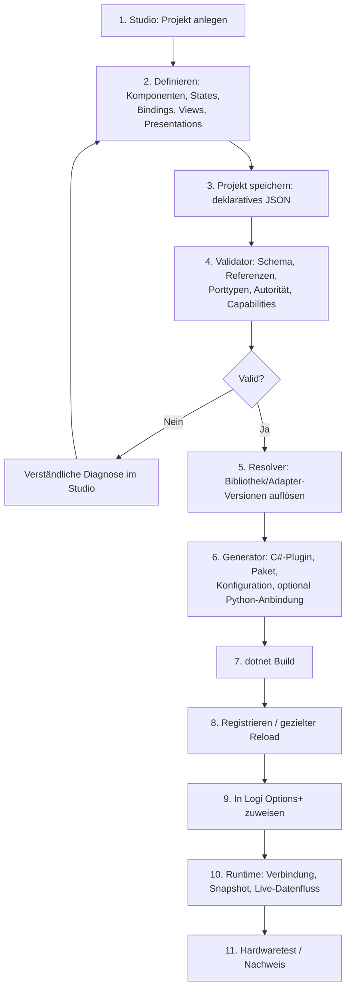
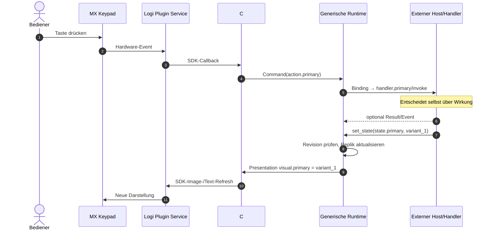

# 05 – Vom bisherigen Projektmodell zum laufenden Logitech-Plugin

> **Aktualisierung 03.11.2026:** Der nachfolgende Buildpfad bildet überwiegend die bisherige Core-basierte Implementierung ab. Die **künftige Zielkette** folgt [ARCH-ADR-001](decisions/ARCH-ADR-001.md): native Logitech-Action-/Parameter-/State-/Folder-/ICT-Verträge → nur notwendige Python/C#-Bridge → optionale Studio-Komfortfunktionen. [Mapping/Gaps](specifications/sdk-native-modellabgleich-v01.md).

**Status:** Zielablauf auf Basis der Architektur. Die heutige Studio-v0.2-Implementierung deckt nur Teile davon ab; der generische Pfad ist noch umzusetzen.

## 1. Die Transformationskette – ohne vorausgesetzten Chatverlauf



### Wer entscheidet was?

| Schritt | Entscheidungsträger | Ergebnis |
|---|---|---|
| Projekt anlegen | Benutzer / Studio | stabile Plugin-ID, Name, Speicherort |
| Komponenten wählen | Benutzer / Typkatalog | Referenzen auf bekannte ComponentTypes |
| Instanzen konfigurieren | Benutzer / Schema-Editor | beliebig viele ComponentInstances mit individuellen IDs |
| Ports verbinden | Benutzer / Binding-Editor | typisierter Graph |
| States und Views definieren | Benutzer / Zustand-/Layouteditor | Projektdefinition ohne Demo-Grenzen |
| Modell validieren | Core Model + Capability-Resolver | Diagnosen oder zulässiges Modell |
| Implementierung zuordnen | Bibliothek + Generator | passende C#-/Python-Bausteine |
| Plugin registrieren | Deployment | verwaltbare Installation und gezielter Reload |
| Ausführen | Runtime + Host-/Geräteadapter | Commands, Events, States und Anzeige |
| Hardware bestätigen | Nutzer / Testlab / Reviewer | Nachweisstatus mit konkretem Build |

## 2. Zwei verschiedene Arten von Änderungen

**Design-Änderung:** Ein Benutzer legt eine völlig neue, zuvor unbekannte Aktion an oder ändert grundlegende SDK-Registrierungen. Sie verändert die *Projektdefinition* und kann einen erneuten Build/Reload verlangen.

**Runtime-Änderung:** Eine externe Anwendung ändert den Wert eines States, die gewählte Präsentationsvariante oder eine dynamisch erlaubte View-Mitgliedschaft. Sie verändert **nicht automatisch** das gespeicherte Projekt. Die Runtime synchronisiert diesen Override zur Hardware, sofern dessen Capability verfügbar ist.

Diese Trennung muss die Studio-Oberfläche sichtbar machen („Projekt wurde geändert“ vs. „momentaner Laufzeitzustand wurde geändert“).

## 3. Ein fachneutraler Durchlauf einer Taste

Wir nehmen bewusst **keinen** Aufnahmeserver, keine Lautstärke und keinen spezifischen Fachzustand an. Das Projekt definiert:

- `action.primary`: Instanz des Bibliothekstyps `core.command_action`.
- `handler.primary`: Instanz eines externen Handler-Vertrags.
- `state.primary`: Enum-Wert `variant_0 | variant_1`, dessen Autorität extern liegt.
- `visual.primary`: zwei Anzeigen `variant_0` und `variant_1`.
- `binding.command`: Action-Ausgang → Handler-Eingang.
- `binding.visual_state`: State-Ausgang → Presentation-Selector.
- `view.main` mit `placement.primary`, das die Aktion sichtbar macht.



**Einschränkung:** Diese vollständige generische Runtime ist ein **Zielbild**. Der heute getestete Lab-Mechanismus verwendet konkret `POST /event`, `GET /state` und C#-Callbacks. Das Modell soll später diese technische Besonderheit abstrahieren.

## 4. Der Neustartfall – warum der aktuelle State nicht aus Events rekonstruiert wird

```mermaid
sequenceDiagram
  participant H as Host (Authority)
  participant R as Runtime
  participant C as C# Adapter
  participant D as Keypad
  Note over C: Logitech-Service wird neu gestartet
  C--xR: Verbindung getrennt
  R->>R: Quality = stale; letzten Wert bewahren
  C->>R: Neuer Handshake (neue Session)
  R->>H: autoritativen Snapshot anfordern
  H-->>R: Snapshot + Revision
  R->>C: aktueller Zustand + Views
  C->>D: Anzeige neu aufbauen
  R->>R: Quality = fresh nach gültiger Synchronisation
```

- Ein `stale`-Wert ist nicht automatisch falsch; seine Aktualität ist nur nicht gesichert.
- Ein Fallback ist ein **Anzeigehinweis**, kein fälschlich behaupteter Anwendungswert.
- Im Testlab blieb der Counter über den *Logitech-Service-Neustart* erhalten, weil Python weiterlief. Das belegt nicht, dass der Wert nach Ende des Python-Prozesses persistiert wäre.

## 5. Wie aus der Bibliothek ein konkretes Gerät-plugin entsteht

**Komponentenbibliothek** sagt: „Ich stelle einen generischen CommandAction-Typ mit Input-/Output-Portverträgen bereit.“

**Studio-Projekt** sagt: „Ich verwende diesen Typ drei Mal, jeweils mit anderen IDs, und platziere zwei der Instanzen in verschiedenen Views.“

**Generator** sagt: „Die ausgewählten Typen werden mit diesen Projektdefinitionen auf die vorhandenen SDK-Adapter abgebildet.“

**C#-Plugin** stellt konkrete SDK-Actions für Logi Options+ bereit, verarbeitet Hardware-Callbacks und sendet Darstellungs-Updates.

**Python-Host** stellt die von ihm implementierten Handler bereit und ist – sofern er State-Authority ist – die Quelle für gültige Werte/Snapshots.

**Hardware** stellt nur dar und liefert Bedienereignisse; sie muss weder das Projekt-JSON noch Python verstehen.

## 6. Welche Dateien tatsächlich ausgeliefert werden

Ein späteres Projekt könnte Folgendes erzeugen (Struktur **illustrativ**):

```text
MeinPlugin/
  project.json                  # EDITIERBARE QUELLE / Wahrheit
  assets/                       # Nutzerbilder und Medien
  generated/                    # ABGELEITET, überschreibbar
    csharp/
      MeinPlugin.csproj
      ... C#-Adapter ...
      package/metadata/LoupedeckPackage.yaml
    runtime/
      ... Host-Adapter / optional Python-Client ...
    module-lock.json            # verwendete Typ- und Codeversionen
  build/
    bin/MeinPlugin.dll          # kompilierte DLL
    metadata/LoupedeckPackage.yaml
  logs/
    ... Diagnosedaten ...
```

Der definitive Dateiname und Deploy-Pfad sind **noch festzulegen**. Wichtig ist die semantische Grenze zwischen `project.json`, `generated/`, `build/` und laufenden State-Daten. Das Studio darf Nutzeränderungen nicht in Dateien verlangen, die beim nächsten Generieren überschrieben werden.

## 7. Wann brauchen wir einen Build, wann nicht?

| Änderung | Zielverhalten / Annahme | Noch zu prüfen |
|---|---|---|
| Plugin-ID oder C#-SDK-Action-Katalog | Build/Registrierung oder Reload | genaue API-/Migrationsregeln |
| neue ComponentInstance mit neuen SDK-Actions | vermutlich Build/Reload | SDK-Registrierungsdynamik |
| aktueller State-Wert | live ohne Build | Authority und Capability |
| Presentation-Variante / Icon / Text | live bei unterstütztem Adapter | Dateiformat und Refresh-Grenzen |
| Mitgliedschaft im Dynamic Folder | live bei passender Capability | atomare Updates und Slotgrenzen |
| Projekt-Layoutdefinition | Projektänderung mit Deployment | Reload/Hot-Reload-Policy |

**Weiter:** [Kommunikation](06_Kommunikation_und_Zustaende.md), [Nachweise](09_Nachweise_und_Abnahme.md).
