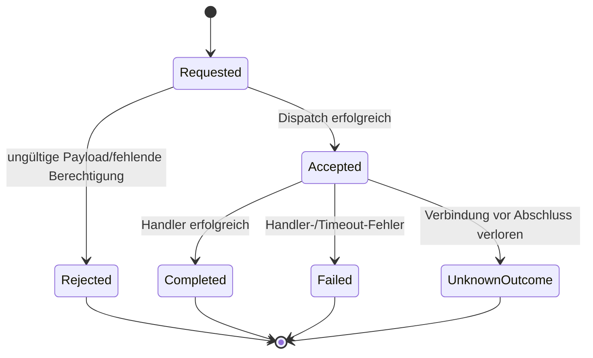
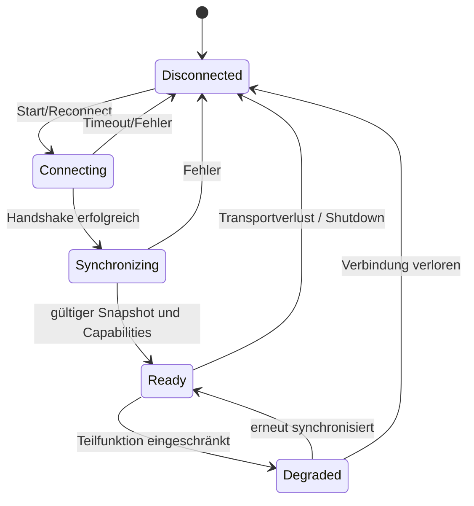

# 06 – Kommunikation, Zustände, Synchronisierung und Lifecycle

> **Geltung 03.11.2026:** Dieses Kapitel beschreibt den bestehenden Python-Host-/Replikationspfad und dessen Sicherheitseigenschaften. Es definiert **nicht** die native `PluginMultistateDynamicCommand`-State-Semantik. Für künftige SDK-nahe State-/Parameter-Verträge gilt [ARCH-ADR-001](decisions/ARCH-ADR-001.md); Altverhalten bleibt bis zur geprüften Migration erhalten.

**Status:** semantische Baseline angenommen; konkrete Signaturen, Schemas, Transport und Timing noch im Entwurf.

## 1. Vier streng getrennte Aufgaben

| Mechanismus | Zweck | Beispiel *ohne* Fachsemantik |
|---|---|---|
| **Command** | Operation anfordern | `command.requested(action.primary, payload={})` |
| **Event** | bereits eingetretenes Vorkommnis mitteilen | `event.occurred(event.primary, payload={})` |
| **State** | aktuellen Wert lesen/setzen/beobachten | `state.primary = variant_1` |
| **Health/Lifecycle** | Erreichbarkeit und technische Bereitschaft bewerten | `connection = online`, `quality = stale` |

**Regel:** Dass ein Command angenommen wurde, ist weder ein fachlicher Erfolg noch ein State-Wechsel. Ein Event darf nicht allein die aktuelle Wahrheit definieren. Ein Heartbeat darf nicht als domänenspezifischer „Start“-Callback missverstanden werden.

## 2. Command-Flow und Fehlerpfade



Dies ist ein **konzeptionelles Zustandsdiagramm des Command-Vorgangs**, keine verpflichtende StateMachine für jede Benutzeraktion.

- Requests brauchen eindeutige Message-IDs; Results/Failures eine Zuordnung über `correlation_id`.
- Nicht jede Operation ist idempotent. Eine automatische Wiederholung könnte beispielsweise eine zweite unerwünschte Ausführung erzeugen.
- Keine pauschale Exactly-once-Zusage. Retry-, Dedup- und Timeout-Policies gehören in einen expliziten Vertrag.
- `UnknownOutcome` darf nicht unbemerkt als `Failed` oder `Completed` ausgegeben werden.

## 3. State-Flow

1. Die StateDefinition legt Datenschema, Autorität, Scope, Lebensdauer, Persistenz und Fallback fest.
2. Ein autorisierter Writer ändert den Wert und erhöht die Revision innerhalb des festgelegten Ordnungsraums.
3. Die Runtime prüft Schema und Autorität, nimmt die Änderung an oder weist sie mit Diagnose zurück.
4. Replikate und gebundene Presentations werden aktualisiert.
5. Neue/neu verbundene Adapter beziehen den **Snapshot**, nicht nur alle irgendwann verpassten Events.

**Mehrere Writer** sind nicht automatisch zulässig. Im ersten Basismodell gibt es genau einen autoritativen Writer pro State-Scope. Konfliktauflösung durch CRDT, Merge oder Last-Writer-Wins ist **nicht beschlossen**.

### Snapshot-Semantik

Ein Snapshot umfasst den vollständigen autoritativen Zustand für einen bezeichneten Scope und eine eindeutig interpretierbare Revision/Epoche. Änderungen während eines Snapshot-Transfers erfordern eine Konsistenzregel (z. B. atomarer Snapshot oder Updates nach Snapshot-Revision puffern). **Welche Regel konkret gilt, ist noch zu entscheiden.**

### Replizierte Wertqualität

- `unknown`: noch kein bestätigter Ist-Wert.
- `fresh`: nach Vertrag synchronisiert.
- `stale`: letzter Wert liegt noch vor, aber Quelle oder Revision sind nicht mehr verlässlich aktuell.

Bei Verlust der Verbindung bleibt ein letzter Wert möglich; `quality` ändert sich unabhängig vom eigentlichen Wert. Eine Anzeige kann „Verbindung verloren“ visualisieren, ohne den ursprünglichen State mutwillig auf `false` zu setzen.

## 4. Lifecycle-Vertrag



`Ready` bedeutet **technisch bereit für den Vertragsumfang**, nicht dass eine bestimmte fachliche Aktion erfolgreich war. `Health` und `Readiness` unterscheiden sich: Ein Prozess kann leben, aber noch keinen gültigen State-Snapshot haben.

Heartbeat-Intervalle, Timeouts und Backoff-Strategien bleiben **Policies**. Sie werden nicht global pro ComponentInstance als zwingende Start-/Stop-/KeepAlive-Callbacks modelliert.

## 5. Minimales logisches Nachrichtenformat

**Nur illustrativ; noch kein verabschiedetes Transport-JSON:**

```json
{
  "schema_version": "draft-0.1",
  "type": "state.changed",
  "message_id": "msg.001",
  "source": "runtime.host",
  "runtime_instance_id": "inst.001",
  "session_id": "session.001",
  "timestamp": "2026-10-29T12:00:00Z",
  "payload": {
    "state_id": "state.primary",
    "value": "variant_1",
    "revision": 8
  }
}
```

| Feld | Aufgabe |
|---|---|
| `schema_version` | Kompatibilität des Nachrichtenvertrags |
| `type` | Unterscheidung von Command, Event, State, Snapshot, Health |
| `message_id` | Nachverfolgbarkeit/Dedup |
| `source` | erzeugender Teilnehmer, nicht beliebige Anzeige |
| `runtime_instance_id` / `session_id` | Ursprungslaufzeit und Sitzung auseinanderhalten |
| `timestamp` | Diagnose/Zeitbezug, **keine** alleinige Ordnungsregel |
| `correlation_id` | optionaler Command-Result-Bezug |
| `payload` | entsprechend Typ/Port schemavalidierte Daten |

Transporte wie Loopback-HTTP, WebSocket oder andere IPC-Mechanismen sind **Adapterdetails**. Die öffentliche Python-Schnittstelle soll unabhängig davon bleiben.

## 6. Sicherheit und Isolation

Für das erste Windows-/Python-Szenario vorzusehen, aber noch **nicht final designt**:

- Nur Loopback-Binding; keine unabsichtliche Freigabe des Steuerports im Netzwerk.
- Port-/Prozessidentität prüfen: falscher laufender Server darf nicht als eigene Runtime gelten.
- Authentisierung/Autorisierung auch lokal prüfen; `127.0.0.1` allein ist keine vollständige Sicherheitsgrenze gegenüber anderen lokalen Prozessen.
- Eingangsgrößen, Datenschema, Anzahl gleichzeitiger Anfragen und Timeouts begrenzen.
- Keine unkontrollierte Skriptausführung aus Projektdateien; Python-Handler gehören in explizit angegebene und vertrauenswürdige Laufzeitmodule.
- Fehler transparent loggen, aber keine sensiblen Anwendungsdaten unnötig protokollieren.
- Installations- und Reload-Aktionen auf das beabsichtigte Plugin begrenzen.

## 7. Anschluss an PySide6

Die generische Python-API soll aus Worker-/Netzwerk-Threads **nicht direkt Qt-Widgets manipulieren**. Ein Qt-Adapter kann Events als Signals in den GUI-Thread dispatchen. Der Runtime-Kern bleibt Qt-unabhängig, damit auch Konsolen- oder Serveranwendungen dasselbe Plugin nutzen können.

## 8. Noch abzuarbeitende technische Verträge

- Nachrichtenformat, Protokollversion, Handshake-/Capability-Negotiation.
- deterministische Revisions-/Snapshot-Sequenz bei gleichzeitigen Änderungen.
- Event-Reihenfolge, Backpressure, Duplicate-/Retry-Policy.
- Authority-Rollen-Auflösung und Mehrfachprozess-Instanzen.
- Localhost-Security-/Port-Discovery-Vertrag.
- optionale Persistenz und Value-Recovery nach Host-Neustart.

**Weiter:** [Entscheidungsregister](08_Entscheidungsregister.md), [Metamodell](03_Metamodell.md).


## Fortschreibung: Beschluss T1–T6 vom 30.10.2026

Die ursprünglichen Schema- und Nachrichtenbeispiele auf dieser Seite bleiben **illustrativ**. Für die verbindlichen Runtime-Grundsätze gelten die [sechs freigegebenen RT-ADRs](decisions/README.md):

- Scope im Runtimebetrieb: `runtime`, `component`, `placement`; `project` aus dem bisherigen Draft-JSON bedeutet runtimeweit innerhalb dieser einen Ausführung. Kein regulärer fachlicher `session`-Scope in V1.
- Schreibautorität: genau ein maßgeblicher Writer je konkretem Scoped State, Rolle `host`, `component` oder `runtime`, von der kurzlebigen Verbindung getrennt.
- Synchronisierung: Snapshot und Deltas; bei Lücken/Autoritätswechsel Re-Sync; Authority-Epoch und Revision statt bloßem Zeitstempel; Nutzwert und `unknown/fresh/stale` getrennt.
- Eine Host-Anwendung pro generiertem Plugin in V1, ohne Einschränkung auf Starttaste oder Dynamic Folder. Unterschiedliche Plugins dürfen parallel ausgeführt werden.
- Die Reihenfolge und Rückgabeformate des In-Memory-Spikes bleiben `SPIKE_ONLY`; das Nachrichtenformat oben ist **nicht** die verabschiedete Wire-Spezifikation.

**Implementierungsgrenze:** Der erste StateStore darf lokale, reproduzierbare State-Änderungen und Snapshots implementieren; ein Host-/SDK-Transport und dessen atomare Re-Synchronisierung benötigen später einen eigenen Vertrag.
