# 07 – Studio-Seiten, Komponentenbibliothek und Geräteadapter

> **Zielarchitektur ab 03.11.2026:** [ARCH-ADR-001](decisions/ARCH-ADR-001.md) setzt das **SDK als fachliche Quelle**; die folgenden generischen ComponentTypes und Adaptervorschläge sind die **bisherige Entwurfs-/Implementierungslinie**, nicht mehr die vorgeschriebene Grundlage für neue SDK-Typen. Komfort- und Bibliotheksfunktionen gehören in eine optionale Schicht. [SDK-Mapping](specifications/sdk-native-modellabgleich-v01.md).

**Status:** konzeptioneller Produktentwurf. Nicht mit dem Funktionsstand des Studio-v0.2-Prototyps verwechseln.

## 1. Zielbild des visuellen Editors

Das Studio besteht langfristig aus mehreren Ansichten über **dasselbe Projektmodell**. Keine Seite darf ein isoliertes Zweitmodell mit eigenem Interpretationsverhalten führen.

| Editorbereich | Bearbeitet | Validierungen / Querverweise |
|---|---|---|
| Projekt | Project-ID, Anzeigename, Metadaten, Zieladapter, Speicherort | Plugin-ID-Stabilität, Pfade, Versionsregeln |
| Komponentenkatalog | auswählbare ComponentTypes | Manifestversion, Capabilities, Abhängigkeiten |
| Aktionen / Instanzen | ComponentInstances mit Typ und Konfiguration | Portvertrag, IDs, erlaubte Konfiguration |
| State-Editor | StateDefinitions, Typ, Autorität, Scope | Default/Fallback, Writer-Eindeutigkeit |
| Port-/Binding-Editor | Binding-Graph, Mappings, Conditions | Typ-/Signal-Kompatibilität, Zyklen |
| Views und Ordner | Views, Placements, Reihenfolge, Navigation | Layoutkapazität, Referenzen, Slotkollisionen |
| Icons / Presentation | Assets, Variantentabellen, Selector | Dateiformate, referenzierte States, Renderlimits |
| Host-Anbindung | Handler-Verträge, Export-/Import-Endpunkte | Callback-Vertrag, Schema, Threading, Verfügbarkeit |
| Build / Installation | Generator, Compiler, Plugin-Registrierung | Integrität, SDK-Version, Fehlerbericht |
| Diagnose / Abnahme | Logs, Runtime-Snapshot, Hardware-Nachweise | kein automatisches „Hardware PASS“ durch Build |

**Wichtig:** Das Studio hat eine Projekt-Vorschau. Ob eine konkrete physische Tastenkombination exakt so auf Hardware erscheint, wird erst durch Geräteadapter und Abnahme bestätigt.

## 2. Wiederverwendbare Komponentenbibliothek

Die Bibliothek ist **kein** Copy/Paste-Speicher der bisherigen Demoaktionen. Sie besteht aus manifestierten ComponentTypes und technischen Implementierungen.

```text
component-library/
  manifest.json (oder Katalog)
  core.command_action/
    1.0.0/
      type.json            # Identität, Config-Schema, Ports
      capabilities.json    # Anforderungen / angebotene Funktionen
      editor.json          # UI-Metadaten
      implementation/      # SDK-/Runtime-Bausteine
      tests/               # automatisierte Prüfungen
      evidence.json        # Ursprung / Hardwaretest / Freigabestatus
```

Dieser Verzeichnisbaum ist **illustrativ** und noch keine verbindliche Dateiformatentscheidung.

### Was ein Baustein mindestens deklarieren soll

- Stabile `type_id`, Version und Kompatibilitätsregel.
- Validierbare Konfiguration, Defaults und Abhängigkeiten.
- PortDefinitionen: Richtung, Signalart, Nutzdaten-/Result-Schemas.
- `capabilities_required` und `capabilities_provided`, inklusive Grenzen und dynamischer Möglichkeiten.
- Runtime-/Adapter-Implementierungszuordnung.
- Editor-Metadaten (automatisch darstellbare Standardcontrols, optional Spezialeditor).
- Test- und Nachweisstatus mit exakter Herkunft.

### Beispiele fachneutraler künftiger Typen

`core.command_action`, `core.dynamic_view`, `core.state_reference`, `core.host_handler`, `core.presentation_selector`, `core.value_adjustment`. Das sind **Kandidaten**, keine heute bereits vorhandenen produktiven Typversionen. Ihre endgültige Aufteilung muss die spätere API-Abnahme festlegen.

## 3. Lab → Bibliothek → Studio

```mermaid
flowchart LR
  A[SDK Lab: experimentell] --> B[Reproduzierbarer Hardwaretest]
  B --> C[SDK-Mechanismus generalisieren]
  C --> D[ComponentType-Manifest + Tests]
  D --> E[Versioniert freigeben]
  E --> F[Studio: ComponentType verfügbar]
  F --> G[Generator: Benutzerkonfiguration]
  G --> H[Studio-generiertes Plugin]
  H --> I[Separater Hardwaretest]
```



Ein Lab-Demo-Script enthält gern `Ping`, `Alpha`, `8/4` oder einen lokalen Counter. Ein **produktiver Baustein** darf solche Beispielwerte lediglich als auswählbare Starter-Beispiele mitbringen, aber nicht als strukturelle Begrenzung.

**Eine Bibliotheksversion** ist nicht identisch mit dem Studio-Release. Ein Generator muss die exakten Modulversionen und Hashes in einem Module-Lock beziehungsweise einer äquivalenten Nachweisliste auflösen.

## 4. Capabilities und Geräteprofile

- **Kernmodell:** beliebig viele logisch modellierte Elemente.
- **Logitech-Adapter:** welche SDK-Aktionstypen werden tatsächlich unterstützt, welche Parameter sind zulässig, welche dynamischen Operationen sind verfügbar?
- **MX Creative Keypad:** konkret sichtbare 3×3-LCD-Anordnung auf dem Gerät; mehr logische Einträge brauchen definierte Navigation/Seitenwechsel.
- **Validierung:** Ein Projekt darf nicht stillschweigend Hardware-Grenzen ignorieren; Lösungsmöglichkeiten können Paging, Navigation oder eine andere Darstellung sein, sofern explizit konfiguriert.

**Neue SDK-native Zielregel:** `PluginDynamicCommand`, `PluginMultistateDynamicCommand`, `PluginDynamicAdjustment`, `PluginDynamicFolder`, `actionParameter` und native Notifications sind **fachlich maßgeblich**. Eine technische Bridge darf diese API über Sprachgrenzen transportieren, sie aber nicht hinter einer verpflichtenden eigenen generischen Action-/State-Semantik verstecken. Die bisherige Core-/Adapter-Trennung bleibt bis zur Migration ein vorhandener Kompatibilitätspfad.

## 5. Warum Python-Callbacks eine Adapterfunktion sind

Ein Projekt bindet beispielsweise einen `command`-Ausgang an einen `handler`-Eingang. **Das ist der aktuelle Legacy-Projektvertrag, nicht die künftig führende SDK-Semantik.** Die Python-API stellt den Handler über ein Callback bereit. Eine andere Hostumgebung könnte denselben Portvertrag anders realisieren.

**Nicht** jeder Command braucht ein Start-, Stop- und KeepAlive-Callback. Lebenszeichen und Reconnect sind Runtime-Mechanismen; fachliche Zustandsmeldungen sind ein optionaler Vertrag zwischen Projektautor und Host-Anwendung.

## 6. Vorsicht bei Build/Reload und Projektsicherheit

- Eine bestehende Plugin-ID wird nicht beim Umbenennen des sichtbaren Labels geändert.
- Die Studio-Generierung überschreibt keine Benutzerimplementierung ohne klaren Schutzbereich.
- Neue SDK-Actions können einen neuen Build/Reload benötigen; eine Zustandsänderung soll nicht denselben Aufwand verursachen.
- Der Builder nutzt einen **gezielten Plugin-Reload**, soweit unterstützt; globale Service-Neustarts sind ausdrücklich bestätigungspflichtige Operationen.
- Getrennte Plugins benötigen getrennte Identitäten und eine konfliktfreie Runtime-Zuordnung; ein allein aus der ID errechneter Port ist nicht automatisch kollisionsfrei.

## 7. Nicht mitgeliefert, aber geplant

Freie GUI-Bearbeitung beliebig vieler Actions, visueller Binding-Graph, generische Python-Clientbibliothek, Laufzeit-Overrides nach neuem Schema, Asset-Editor, Multistate- und Action-Editor-Bausteine. Diese Fähigkeiten dürfen in der Dokumentation nicht als bereits funktionierende Merkmale von Studio v0.2 gekennzeichnet werden.
