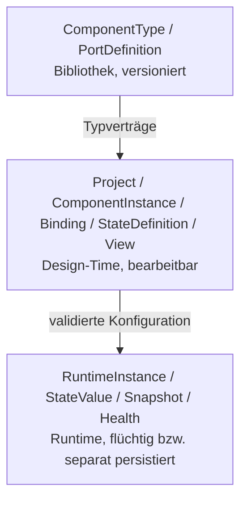

# 11 – P0-Präzisierungen und fachneutraler Kern (v0.4)

> **Historische Quelle mit neuer Folgerichtung:** Seit 03.11.2026 gilt für die SDK-Zielarchitektur [ARCH-ADR-001](decisions/ARCH-ADR-001.md). Die übernommene P0-Review-Erzählung über einen fachneutralen führenden Core bleibt **Historie**, nicht Neuentwicklungsauftrag. Frühere Abnahmen werden nicht umgeschrieben.

**Status:** Dieses Dokument enthält **historische P0-Review-Vorschläge aus v0.4**. Seit 30.10.2026 sind die **konkreten sieben P0-ADRs verabschiedet** (ADR-005 eingeschränkt), während weitergehende Details und das finale Projektschema offen bleiben. **Normativ sind nur die Einzel-ADRs**, nicht alle hier als `PROPOSED` zitierten Zwischenstände. Siehe [Beschlussprotokoll](12_P0_Freigabe_2026-10-30.md).

**Quellenhinweis:** Die folgenden zwei Abschnitte übernehmen die inhaltlichen Texte von `docs/01_P0_Review.md` und `docs/03_Kernmodell_und_Szenarien.md` aus dem v0.4-Quellpaket; die Trennung in Review und Beispiel wird beibehalten. Die Originaldateien liegen im historischen Paketarchiv.

---

# P0-Review – Ergebnis und Priorität

**Basis:** `Logi_Plugin_Architecture_Handoff_v0.3/docs/{02,03,04,06,08,10,12}` und dessen abstraktes JSON-Beispiel. **Historischer Status dieses Review-Abschnitts:** Empfehlungen aus v0.4 vor der späteren ADR-Freigabe; überholte Statuswerte in den folgenden Tabellen stellen **keinen aktuellen Beschlussstatus** dar. Aktueller Status: [Entscheidungsregister](08_Entscheidungsregister.md).

## Bestätigt aus der vorhandenen Baseline

- Fachneutraler Kern; keine Aufnahme-/Listening-/Counter-Sonderlogik im Core (`AR-001`).
- Commands, Events, States plus Snapshot/Reconnect/Health als getrennte Mechanismen (`AR-002` bis `AR-004`).
- Design-/Deploy-/Runtime-Trennung, mehrfach platzierbare Komponenten, typisierte Ports/Bindings (`AR-005`, `AR-006`, `AR-008`).
- Gerätespezifische Limits werden durch Adapter-Capabilities abgefangen, nicht in eine feste 4/8-Auswahl eingebaut (`AR-007`, `AR-009`).
- Kein blindes Retry und kein Exactly Once (`AR-012`).

## Die wichtigsten Präzisierungen vor P1

| Nr. | Befund | Konsequenz / Empfehlung | Status |
|---|---|---|---|
| 1 | `ComponentType` und `PortDefinition` gehören zu einer versionierten Bibliothek; `ComponentInstance` zum Projekt. | Manifest und Projektdatei getrennt speichern; referenzierbare Typversion pinnen. | PROPOSED |
| 2 | `RuntimeInstance`, aktuelle State Values und TCP-Verbindungsdaten sind keine Designobjekte. | Aus dem statischen Projekt-JSON ausschließen. | PROPOSED |
| 3 | String-Referenzen wie `component:a/b` sind lesbar, aber bei Rename, escaping und Editor-Operationen unnötig fehleranfällig. | Strukturierte Endpunktreferenzen `{owner_kind, owner_id, port}` einsetzen. | PROPOSED |
| 4 | `state` und `presentation` sind im Metamodell eigenständige Entitäten, besitzen aber keine ComponentType-Manifeste. | Einfache virtuelle Ports `value` (State/out) und `selector` (Presentation/in) als explizite Standardverträge definieren. | PROPOSED |
| 5 | Allgemeines JSON-Schema-Subtyping ist komplex; ein unvollständiger Kompatibilitätscheck könnte ungültige Bindings akzeptieren. | P1 validiert gleichartige einfache Typen und verlangt im Zweifelsfall Schema-Gleichheit oder expliziten Konverter; keine behauptete Vollständigkeit. | PROPOSED |
| 6 | Eine Revision allein ist nach Prozessneustart nicht eindeutig (Zähler kann wieder bei 1 beginnen). | Für spätere Runtime-Syncs `authority_generation + revision` pro State-Scope definieren; P1 noch ohne Runtime. | PROPOSED |
| 7 | `Placement` muss mehrfach auf dieselbe ComponentInstance zeigen dürfen. | Placement eigene ID, `position` eindeutig innerhalb View, jedoch keine feste Hardware-9-Grenze im Core. | PROPOSED |
| 8 | `ComponentType`/SDK-Capabilities sind mit Kompatibilitätsgrenzen verbunden. | Statische Validierung in zwei Stufen: Core-Modell-Konsistenz zuerst, Adapter-Deployfähigkeit später. | PROPOSED |
| 9 | Die Quelle `Command` ist nicht automatisch das Ereignis des Erfolgs. | Ergebnisse als korrelierte Rückmeldung führen, nicht als implizite State-Änderung. | BASELINE (AR-012) |
| 10 | Das v0.3-Beispiel hat Referenzen und Daten, aber kein eigenständiges Manifest mit Ports zum eigentlichen Bindingcheck. | Neues *zusätzliches* Beispiel mit zwei ComponentType-Manifests; v0.3-Beispiel unverändert lassen. | PROPOSED |

## Was wir **nicht** vor P1 entscheiden müssen

- Realer Transport (HTTP/WebSocket/Pipes), Tokens, Port-Discovery und Qt-Signaladapter (`OP-007`/`OP-008`).
- SDK-Action-Registrierung/Reload und weitere Hardware-Capabilities (`OP-009`/`OP-010`).
- Umfassende Automations-/Expression-Language, Hot-Deploy und parallele Runtime-Konfliktauflösung (`OP-004`/`OP-005`).
- Legacy-Migrationen und Python-State-Persistenz (`OP-011`/`OP-012`).

## Besonders wichtige Abnahmeregel

Ein funktionierender JSON-Spike ist **kein** Beweis, dass alle MM-Vorschläge akzeptiert oder alle echten Logitech-SDK-Limits bekannt sind. P0 prüft Modellkonzepte; P1 liefert einen validierbaren Core; P2 testet Runtime-Semantik; P3 liefert reale Hardwareevidenz.

---

# Minimaler Core – Was die Entitäten leisten (ohne fachliche Semantik)

**Status:** erläuternder Entwurf. Keine Änderung der v0.3-Baseline.

## 1. Drei getrennte Sichten

Die **Typbibliothek** sagt, was eine Komponente darf. Das **Projekt** sagt, wie diese Typen kombiniert werden. Die **Runtime** hält laufende Instanzen, Werte und Nachrichten. Der Logitech-Adapter übersetzt nur das technische Ergebnis auf Hardware. Weder das SDK Lab noch das Studio sollten der alleinige Runtime-State-Owner sein.

## 2. Minimale Datenerzählung

Das Beispiel [`examples/project_v0_1_draft.json`](../examples/project_v0_1_draft.json) deklariert:

- Einen allgemeinen `core.command_action` und einen `core.host_handler` (keiner kennt „Recording“).
- Einen Command-Binding-Pfad `action.primary/activated → handler.primary/invoke`.
- Einen State `state.primary` mit den Werten `variant_0` und `variant_1` und definierter Autoritätsrolle.
- Eine visuelle Presentation mit zwei Varianten, deren Selector vom State gespeist wird.
- Zwei Views mit zwei Placements **derselben** `ComponentInstance`.

Der deklarative Weg hat noch keine ausgeführte Callback- oder State-Transition. Ein `handler`-Name ist in diesem Beispiel nur ein vertraglicher Anschluss, keine frei ausführbare Scriptzeile.

## 3. Warum „ComponentInstance“ und „Placement“ nicht dasselbe sein dürfen

Ein ComponentType kann viele ComponentInstances haben. Jede Instanz kann viele Placements haben. Wenn zwei Placements die gleiche Instanz anzeigen, ist eine Änderung ihrer zugrunde liegenden State-Quelle grundsätzlich gemeinsam sichtbar; die Darstellungsobjekte können dennoch unterschiedlich sein.

Deshalb dürfen `position`, `icon`, `view` und `component_id` nicht zur selben unveränderlichen Identität verschmolzen werden.

## 4. Welche Regeln P0 bereits technisch testet

- IDs, Verweise und Typversionen;
- Komponenten-Konfiguration gegen ein minimales Schema;
- Port-Richtung und Signalart;
- konservative Nutzdatenkompatibilität ohne implizite Konverter;
- Fallback gegen Value-Schema;
- Mehrfach-Placements und Positionskollisionen;
- deterministische Serialisierung;
- strukturierte Diagnose-Codes.

## 5. Was der Spike ausdrücklich **nicht** testet

- Vollständige JSON-Schema-Regeln oder alle JSON-Schema-Subtyping-Fälle.
- Security/Trust, lokale Transportbindung, technische Synchronisierung, Reconnect, Session-Grenzen.
- Bindings als ausführbarer Graph, Conditions/Mapping, Result-Korrelation, Event-Verarbeitung.
- Reale C#-Klassen, Logitech-Action-Registrierung, tatsächliche maximale Ordnergröße.
- UI-Modelle für Studio oder spätere flexible Editoren.
- Volle Kompatibilitätsprüfung von Typmanifests, semantische Component-State-Scope-Auflösung.

Diese Punkte gehören in P1/P2/P3 und müssen explizit nachgewiesen werden.

## 6. Abnahmefähiger nächster Durchstich

P1: das neue abstrakte Modell korrekt einlesen/validieren. P2: simuliert `command → handler → state → presentation` ausführen. P3: genau **diesen einen** Pfad durch den echten Logitech-Adapter führen. P4: denselben Vorgang aus dem Editor definieren, ohne das JSON oder generiertes C# manuell zu ändern.

## Referenzen im konsolidierten Projekt

- [Entscheidungsregister](08_Entscheidungsregister.md) – normativer Status
- [P0-ADR-001 bis -007](decisions/README.md) – jetzt freigegebene Einzeldokumente (ADR-005 mit Einschränkung)
- [Schemaentwurf](../schemas/project_v0_1_draft.schema.json), [Beispielprojekt](../examples/project_v0_1_draft.json), [Manifest-Beispiele](../component_types/README.md) – experimentelle Spezifikationen
- [Core-Spike](../src/core_spike/README.md) – ausführbare Modellprüfung, kein Runtime-Nachweis
