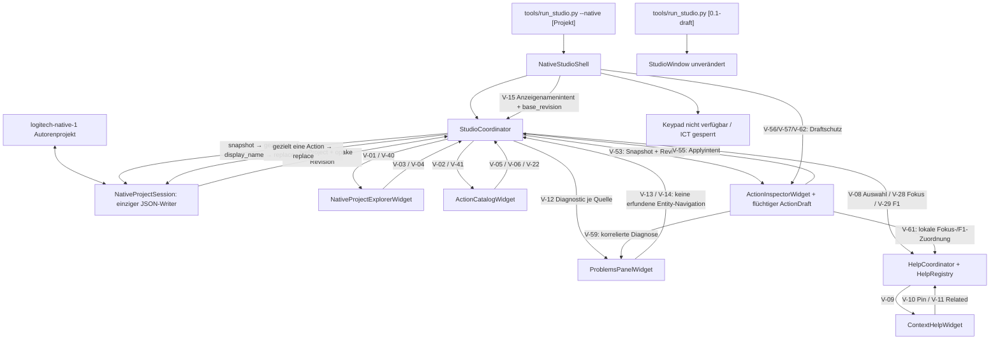
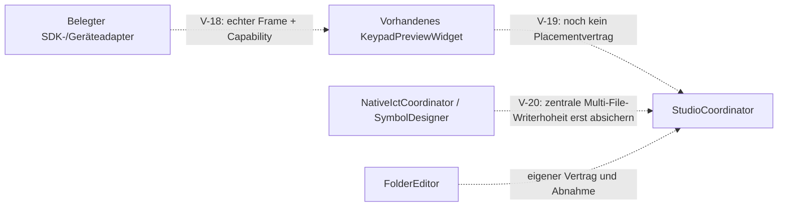
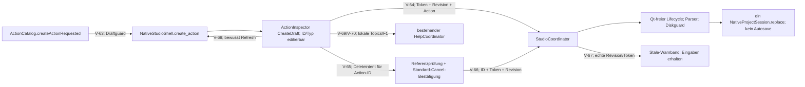

# Gesamtkarte der Studio-Verdrahtung

Stand: 06.11.2026 · AP-STUDIO-002 · unabhängig APPROVED am 06.11.2026. IST beschreibt diese abgenommene Baseline; die unten beschriebene Ergänzung AP-HELP-001 wurde [unabhängig abgenommen](../../../work/acceptance/20261106-help-coverage/ABNAHME.md).

## IST – SDK-native Shell

Keine Verbindung von der nativen Session in das Legacy-Fenster, keine Formatmigration, kein Geräte-/Service-/Profilwriter. Auswahl und Parameter sind flüchtiger Hostzustand; FolderEntry bleibt Placement-ID. Filter dürfen keine unsichtbare aktive Hostauswahl zurücklassen. Programmatische Setter sind still.

## SOLL – getrennte Folgeaufträge

Gestrichelte SOLL-Kanten sind AUFGESCHOBEN und existieren nicht in dieser Shell. Die vorhandene Preview wird ohne belegten Frame nicht instanziiert; es wird keine 9-Tasten-Seite erfunden. Logitech-Service-Profile und LP5 bleiben außerhalb der Schreibdomäne.

## Eigentümer und Nachweise

| Wert | Eigentümer | Aktiver Empfänger |
|---|---|---|
| Vollständiges Autoren-JSON, Revision, History, Diskbaseline | NativeProjectSession | Coordinator; defensive Projektionen an Views |
| Auswahl `(kind,id)` und optionaler Parametername | StudioCoordinator | Explorer, Catalog, read-only Details, Hilfe |
| Diagnostic | Erzeugende Quelle; Hosthülle für unstrukturierte Parserfehler | ProblemsPanel je Quellkanal |
| Themen / aktueller Hilfekontext / Pin | HelpRegistry / HelpCoordinator | ContextHelpWidget |
| Geräteframe / Profilbelegung / ICT-Asset | In diesem AP kein autorisierter Owner | Sichtbarer Sperrhinweis |

Alle tatsächlichen Routen einschließlich Toolbar, Filter und Lebenszyklus stehen mit Testfunktion im [Verbindungsregister](04-Verbindungsregister.md). [Arbeitsakte mit Windows-Evidenz](../../../work/studio-integration/AP-STUDIO-002/README.md).

## Ergänzung AP-HELP-001 – APPROVED

Der native Host besitzt zusätzlich `NativeHelpBindings` in `src/studio/native_shell/help_bindings.py`. V-43 registriert die unveränderten Defaultthemen plus Modulbeiträge unter eindeutigen Quellen; V-44/V-45 bilden lokale Fokus-, Auswahl-, Such-, Filter- und Sortierereignisse auf `HelpContext` ab. V-46 führt F1 explizit zum bestehenden HelpCoordinator; V-47 hält die Bedienung des angezeigten Hilfeartikels stabil. V-48 umfasst eigene Qt-Dialoge, V-49/V-50 belegen ausbleibende Sessionoperationen und die Fenstergrenze, V-51 das Einzelregister und V-52 die Entitätsthemen. `HelpDisplayState → ContextHelpWidget` bleibt der eine bestehende Anzeigeweg V-09.

Kein zweiter HelpCoordinator, kein kopierter Hilfetext aus Widgets und kein globaler Fokusmonitor. Der Host übergibt nur aktuelle geprüfte UI-/Sessionfakten. Keypad- und ICT-SOLL-Kanten bleiben aufgeschoben; ihre Sperrhinweise bekommen explizite Hilfethemen. [Vorher-/Nachher-Coverage, Windows-Tests und Scope](../../../work/help-integration/AP-HELP-001/README.md).

## AP-INSP-001 – implementiert, APPROVED

Der [ActionInspector](widgets/ActionInspector.md) bearbeitet alle vier vorhandenen SDK-Aktionstypen einschließlich strukturierter Parameter, States, Adjustment, EditorControls/Filter und Asset-Referenzen. NativeAction ist weiter nur Leseprojektion. Ein defensiver Qt-freier ActionDraft hält Rohdaten und opake Baserevision; nur bewusst geänderte Felder werden gepatcht. ID und Typ bleiben fest, neue Actions und Folderänderungen bleiben ausgeschlossen.

Auswahl aus Explorer/Katalog beziehungsweise FolderEntry→Action wird vom Host in den permanenten Inspector-Tab projiziert. Katalog-Bearbeiten öffnet diesen Tab; Toolbar-Anzeigename bleibt QInputDialog. Apply führt über `StudioCoordinator.apply_action_edit` zu genau einem `NativeProjectSession.replace`, ohne Autosave. Undo/Redo/Save bleiben dieselbe Sessionhistory. Dirty-Drafts werden unabhängig von Session-Dirty geschützt; Cancel, stale Revision, DiskConflict und fehlgeschlagene Projektwechsel erhalten Eingaben. Alle Ansichten werden nach erfolgreichem Commit frisch projiziert; Dirty-Refresh überschreibt keine Felder.

Die eine bestehende Hilfe erhält Quelle inspector mit 13 Topics (55 insgesamt). Lokale `inspectorTopic`-Eigenschaften gelten auch für dynamische Zeilen/Filter; Host-F1/FocusIn/Pin/Related zeigen keine Rohdaten. [Register V-53–V-62](04-Verbindungsregister.md), [Arbeitsakte, Tests und Windows-Bilder](../../../work/action-inspector/AP-INSP-001/README.md). Unabhängige Abnahme am 06.11.2026 erfolgt; AP-INSP-002 bleibt Folgeplanung.

## IST-Ergänzung AP-INSP-002 – APPROVED

NativeAction bleibt Leseprojektion. CreateDraft ist transient, kein Store. `FoldSection` ist lokales Sichtbarkeitsverhalten ohne Fachkante. Der fenstereigene Beobachter nutzt dieselbe Sessionrevision und Diskbaseline. Nach Create selektierte neue Definition unplatziert; nach Delete Auswahl leer, Offers frisch. [Tatsächliche APIs](widgets/ActionLifecycle.md), [prüfbare Kanten](04-Verbindungsregister.md).

## Ergänzung AP-FOLDER-002: Studio-Tab und separater Extensionwriter

`NativeStudioShell → StudioCoordinator.prepare_project → (NativeProjectSession, ExtensionStore)` bereitet beide Dateien ohne Mutation der bisherigen Sitzung vor. Erst nach allen Dirty-Entscheidungen wird das frisch geladene Paar aktiviert. `Coordinator.changed → FolderComposer.set_native_snapshot` liefert defensive aktuelle SDK-Actiondaten. Der Composer hält nur Referenzen.

`FolderComposer → ExtensionStore.commit/undo/redo/save/export → <Projektstamm>.vfolders.json` ist eine getrennte Schreibdomäne. `actionEditRequested → Coordinator.request_edit → vorhandener Inspector` verwendet den vorhandenen Draftguard. Virtuelle Referenzen fließen über `action_delete_check` in die bestehende Löschentscheidung ein. Native Undo-/Redo-Schritte werden vor Ausführung auf neu verwaisende virtuelle Referenzen geprüft. `folders.references` erscheint nur bei tatsächlich fehlenden lokalen Actionzielen.

Native Save und Extension Save sind zwei explizite Aktionen ohne dateiübergreifende Atomarität. Code und eigene Hosttests: [V-74–V-82](04-Verbindungsregister.md).

## Ergänzung AP-STUDIO-FINAL-001: Keypad und ICT

Die oben historisch gesperrten V-18–V-21 sind im Studio über den [Keypad- und ICT-Vertrag](NativeKeypadAndIct.md) angeschlossen. Der Frame liest die native Session und bei virtueller Quelle den bestehenden FolderComposer. Intents schreiben weiterhin nur beim zuständigen Owner. Der modale SymbolDesigner nutzt die native Session für die Projektzuordnung und liefert nach erfolgreicher ICT-Persistenz einen Ansichtsrefresh.
